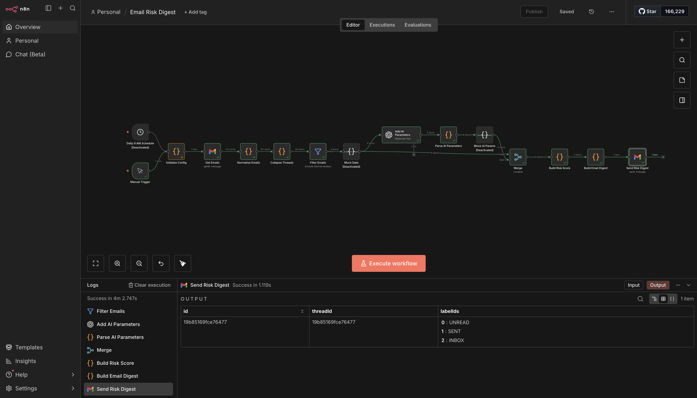
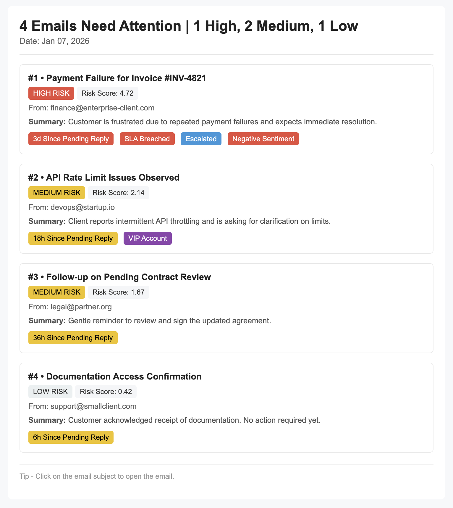

# Awesome n8n Workflows

A collection of production-ready n8n workflows for automating common business processes.

## Daily Email Risk Digest

This workflow automates the analysis of incoming emails by calculating risk scores, categorizing messages by priority level, and delivering a consolidated HTML digest. The system helps prioritize inbox management by surfacing high-risk communications that require immediate attention.

### Workflow Architecture



The workflow processes email data through multiple stages: initial extraction, content analysis, risk calculation, categorization, and digest generation.

### Features

- Multi-factor risk scoring based on response time, escalation status, and sentiment
- Dynamic categorization into High, Medium, and Low priority buckets
- AI-powered content summarization and sentiment analysis
- Automated HTML digest generation with inline styling
- Configurable SLA thresholds and risk parameters

### Sample Output



The generated digest groups emails by risk category and includes sender, subject, calculated risk score, and AI-generated summary for each message.

## Risk Scoring Algorithm

The risk calculation uses a weighted approach that considers multiple dimensions:

```
response_risk = min(1, pending_hours / SLA_hours)

escalation_risk = 1

sentiment_risk ∈ {0, 0.5, 1}

base_risk =
  0.55 * response_risk +
  0.30 * escalation_risk +
  0.15 * sentiment_risk

urgency_factor =
  1 + log2(1 + pending_hours / 4)

final_score =
  base_risk *
  urgency_factor *
  importance_multiplier
```

Response risk increases linearly with time relative to SLA. The urgency factor applies logarithmic scaling to amplify time-sensitive messages. Sentiment risk adjusts for negative or neutral tone detection.

## Installation

1. Import the workflow file into your n8n instance: `workflows/Daily Email Risk Digest.json`
2. Configure your email source node with appropriate credentials
3. Update the SLA threshold parameters in the risk calculation node
4. Set up your email output credentials for digest delivery
5. Test the workflow with sample data before scheduling

## Usage

The workflow can be triggered manually or scheduled to run at regular intervals (e.g., hourly or daily). Configure the schedule node based on your inbox volume and urgency requirements.
